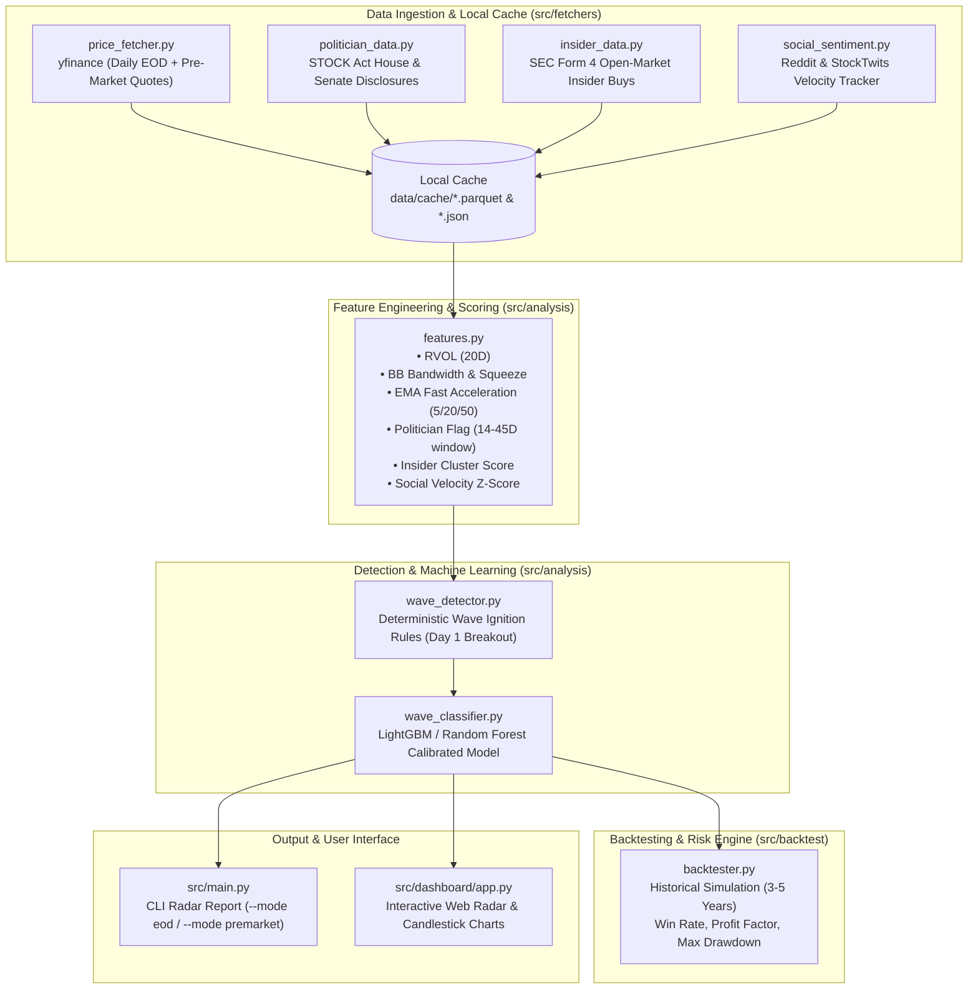

# Wave Rider: High-Probability Swing Momentum Engine
## System Architecture & Technical Specifications Document

- **Author / Role**: Solutions Architect & Quantitative Systems Engineering Team
- **Project**: `predict-stock`
- **Status**: Proposed / Architectural Blueprint
- **Target Platform**: Local Environment (Windows / Python 3.12)
- **Zero-Cloud / Zero-LLM Runtime Mandate**: 100% Local Execution, Zero Ongoing API Costs

---

## 1. Executive Summary & Strategy Formulation

### 1.1 Problem Statement
Retail traders frequently suffer from "chasing the top"—entering momentum moves on Day 3 or Day 4 after mainstream coverage, only to be stopped out during standard institutional mean-reversion pullbacks. Conversely, purely speculative penny-stock momentum carries catastrophic downside (dilution, delisting, bankruptcy).

### 1.2 The "Wave Rider" Thesis
This solution is an automated quantitative scanning, classification, and tracking system designed to identify and exploit **multi-day momentum expansions (3–5 trading days)** specifically in **fundamentally sound, non-speculative US equities**. 

A sustained multi-day "wave" in a mega-cap or semiconductor leader does not occur by chance. It is systematically driven by:
1. **Accumulation Footprints**: Prior positioning by influential market participants (US Congressional STOCK Act disclosures and Corporate C-Suite Form 4 Insider Buys).
2. **Ignition Triggers**: High Relative Volume ($\text{RVOL} \ge 1.5\times$) coupled with price range expansion (clearing 20-day resistance or Bollinger Band squeeze breakouts).
3. **Retail & Social Feedback Loops**: Discussion velocity spikes on social platforms (Reddit, StockTwits) reinforcing the continuation leg of the move.

### 1.3 Asymmetric Risk Profile
- **Safety Floor**: By constraining the trading universe strictly to blue-chip tech titans and essential semiconductor infrastructure, "bad trades" do not face insolvency risk. If a position fails to expand in 5 days, it can be held as an institutional-grade asset or exited with minimal slippage.
- **Asymmetric Payoff**: Calibrated to capture $+3.5\%$ to $+6.0\%$ upside over 3–5 days against a fixed/trailing $-2.0\%$ to $-2.5\%$ stop-loss ($2.5:1$ reward-to-risk ratio).

---

## 2. Asset Universe: 27 Verified US Equities

All assets are actively traded with deep liquidity on major US exchanges (**NASDAQ / NYSE**):

| Segment | Tickers | Fundamental Rationale & Wave Profile |
| :--- | :--- | :--- |
| **Pure Memory & Storage** | `MU`, `WDC`, `STX`, `SKHY`, `SNDK` | Highly cyclical; supply/demand inflection points trigger aggressive, multi-day institutional repricing runs. |
| **Capital Equipment (Picks & Shovels)** | `LRCX`, `AMAT`, `KLAC`, `ASML` (ADR), `TXN` | Monopolistic/oligopolistic equipment suppliers for 3D NAND, DRAM, and advanced nodes. High operating margins, steady buybacks. |
| **AI Compute & Enterprise Systems** | `NVDA`, `AMD`, `SMCI`, `DELL`, `INTC`, `TSM` (ADR) | Core drivers of data center capex. High institutional block volume and high beta. |
| **Connectivity & Custom Silicon** | `AVGO`, `QCOM`, `ARM` (ADR), `MRVL` | Data center interconnects, optical DSPs, edge AI. High correlation with Congressional trade disclosures. |
| **Mega-Cap Anchors & High-Beta Momentum** | `MSFT`, `AAPL`, `GOOGL`, `AMZN`, `META`, `TSLA`, `SPCX` | Unshakable balance sheets (AAA/AA credit rating). Massive cash generation; provide safe ballast and liquid swing setups. |

---

## 3. System Requirements

### 3.1 Functional Requirements (FR)
- **FR-01: Dual-Cadence Scanning Engine**
  - **End-of-Day (EOD) Mode**: Runs at ~22:00 CET (post-US market close). Evaluates full daily candle, volume expansion, and newly filed after-hours SEC/Congressional disclosures to produce tomorrow's target watchlist.
  - **Pre-Market (PM) Mode**: Runs at ~14:30–15:15 CET (pre-US market open). Ingests overnight futures, pre-market quotes, and gap percentages to validate or invalidate the EOD thesis before the opening bell.
- **FR-02: Smart Money Ingestion Pipeline**
  - Ingest US Congressional disclosures (STOCK Act) via public House/Senate repositories.
  - Ingest Corporate Insider transactions (SEC Form 4 open-market purchases by Officers/Directors).
- **FR-03: Social Trend & Buzz Tracker**
  - Track mention velocity and sentiment acceleration across public feeds (Reddit r/stocks, r/wallstreetbets, StockTwits) without paid API keys.
- **FR-04: Technical Wave Detection & Feature Pipeline**
  - Compute technical indicators: Relative Volume (RVOL), ATR%, Bollinger Band Width, EMA Spreads, Distance to 20D/50D Highs.
- **FR-05: Machine Learning Wave Classifier**
  - Binary classifier generating a probability score: $P(\text{Gain} \ge +3.5\% \text{ in 5 days } \mid \text{Drawdown} < 2.5\%)$.
  - Filter out false breakouts (bull traps).
- **FR-06: Interactive Local Dashboard & Visualizer**
  - Web UI (Streamlit or lightweight local web app) displaying the daily radar table, candlestick charts, entry/stop-loss/target levels, and smart money contextual badges.

### 3.2 Non-Functional Requirements (NFR)
- **NFR-01: 100% Local & Self-Contained Execution**
  - Zero external LLM calls or cloud API subscriptions at runtime. All ML models, heuristics, and parsers must execute on the local laptop CPU.
- **NFR-02: Performance & Latency**
  - Full scan and classification of all 27 stocks must complete within **$< 5$ seconds**.
- **NFR-03: Zero Ongoing Cost**
  - Built entirely on free, open-source Python libraries (`yfinance`, `pandas`, `scipy`, `scikit-learn`/`lightgbm`, `requests`, `beautifulsoup4`).
- **NFR-04: Data Caching & Offline Resilience**
  - Historical data, filings, and price snapshots cached locally in `data/cache/` (Parquet/JSON) to avoid rate limits and permit offline backtesting.

---

## 4. Architecture Decision Records (ADR)

### ADR-01: Local Python Environment vs. Cloud Infrastructure
- **Decision**: Build the application as a standalone, modular Python project running locally on the user's workstation.
- **Rationale**: Eliminates hosting costs, token fees, and cloud latency while guaranteeing complete privacy for personal watchlists and trading rules.

### ADR-02: Problem Formulation — Classification vs. Price Regression
- **Decision**: Formulate the prediction task as a **Calibrated Binary Event Classifier** rather than a continuous price regression (e.g., predicting exact tomorrow price) or raw time-series forecast (ARIMA/LSTM).
- **Rationale**: Accurate point-in-time price prediction in equity markets suffers from extreme noise and non-stationarity. Conversely, classifying the probability of a discrete, asymmetric momentum regime ($+3.5\%$ target vs $-2.5\%$ invalidation) yields much higher signal-to-noise ratios and maps directly to risk management rules.

### ADR-03: Multi-Factor Signal Weighting (Smart Money + Technicals)
- **Decision**: Treat Technical Breakouts as the **Trigger** (Timing Mechanism) and Smart Money / Social Sentiment as the **Probability Multiplier** (Quality Filter).
- **Rationale**: Technical breakouts without smart-money sponsorship often fail as fake-outs. Conversely, insider or politician buying without a technical catalyst can sit stagnant for months. Combining them ensures capital is deployed only when both motive and momentum align.

### ADR-04: Decoupled Dual-Mode Pipeline (EOD Planning + Pre-Market Execution)
- **Decision**: Separate the analytical engine into an evening EOD scan and a morning Pre-Market confirmation check.
- **Rationale**: Accommodates the user's schedule (not a full-time day trader). The evening scan allows calm review without time pressure; the morning scan provides actionable confirmation in $< 60$ seconds.

### ADR-05: Root-Cause Mitigations from Legacy System Analysis (`stock/`)
- **Context**: A prior implementation in `c:\Users\jonsa\LLM\stock` (EdgeTrader v2.0) failed in real testing. A forensic audit revealed 6 distinct design flaws:
  1. *Trend-Chasing vs. Wave Ignition*: The legacy system assigned 75/100 points simply for being above the 50 SMA / 200 SMA, causing it to buy exhausted late-stage trends rather than Day-1 ignition.
  2. *Unrealistic Swing Targets*: Targets were set at +23% to +37% (e.g. DELL), which were never reached in 3–5 day windows, leaving positions trapped.
  3. *Capital Freeze*: The 3-slot cap filled immediately on Day 1 with low-momentum stocks and locked up capital indefinitely.
  4. *Rigid Break-Even Traps*: Moving stops to break-even on the first small pop resulted in frequent stop-outs right before the wave continued.
  5. *Blind Technicals*: Zero awareness of insider accumulation, Congressional buying, or relative volume in swing mode.
  6. *Watchlist Dilution*: Monitored 50 disparate stocks (airlines, retail) with conflicting market dynamics.
- **Architectural Mitigation in `predict-stock`**:
  - Enforce mandatory Day-1 ignition criteria ($\text{RVOL} \ge 1.5\times$, range breakout).
  - Target calibrated 3–5 day expansions ($+3.5\%$ to $+6.0\%$) with a strict 5-day time stop.
  - Dynamically trail the 5-day EMA instead of premature break-even stops.
  - Require Smart Money (Politician / Insider) and Social Momentum confirmation.
  - Restrict strictly to 27 market-leading US tech and semiconductor titans (expanded to 50 in Week 3 across 4 macro sectors).

### ADR-06: Decoupled Static Asset Architecture & Dual-Mode Client-Side Routing
- **Context**: Migrating the application to zero-cost cloud hosting on GitHub Pages while retaining the option for full local execution with interactive paper-trading order execution.
- **Decision**: Decouple the system into a static compiler (`src/cloud/static_exporter.py`) that exports pre-calculated JSON assets and a Dual-Mode frontend adapter (`apiFetch` in `app.js`).
- **Rationale**:
  1. *Zero Subscription or Server Fees*: Eliminates monthly hosting fees for full-time cloud instances. GitHub Pages serves static bundles globally via high-speed CDN at \$0 cost.
  2. *Graceful Dual-Mode Degradation*: In local Flask mode (`:5050`), interactive paper trading and manual Bot turns work in real time. In cloud static mode (`:5055` / `github.io`), the UI dynamically falls back to pre-rendered JSON snapshots with friendly guidance for state-mutating actions.
  3. *Atomic Immutability*: Static bundles are versioned and can be served locally (`python -m http.server 5055 --directory dist`) for offline forensics and validation.

### ADR-07: Macro Capitulation Reversal Carve-Out During Bear Regimes
- **Context**: In Week 5, benchmark QQQ traded below its 20-day EMA, triggering the Macro Regime Gatekeeper (`FR-08-04`), which froze the Bot 100% in cash. Concurrently, TSLA suffered an extreme -9.5% crash on Day T-1 and rebounded +2.8% on Day T. A quantitative 3-year backtest across all 50 stocks revealed that unconfirmed knife-catching is a losing strategy (PF 0.67–0.82), but confirmed green reversals after an extreme crash (<= -8.0%) possess an empirical winning edge (66.9% Win Rate, 1.37 Profit Factor).
- **Decision**: Implement a strictly controlled Capitulation Reversal Carve-Out in `src/game/duel.py`.
- **Rules**:
  1. *Prior Day Washout*: Return <= -8.0%.
  2. *Day T Green Confirmation*: Close > Open and Close > Prior Close.
  3. *Structural Stop*: Anchored to Low of Day T-1 * 0.995.
  4. *Risk Boundaries*: Max 1 active carve-out position; max 20% bankroll allocation.
- **Consequences**: Enables the Bot to capture high-probability asymmetric mean-reversion bounces during macro bear regimes without compromising the capital protection benefits of the QQQ trend filter.

---

## 5. Technical System Architecture



---

## 6. Mathematical & Quantitative Specifications

### 6.1 Relative Volume ($\text{RVOL}$)
$$\text{RVOL}_t = \frac{\text{Volume}_t}{\frac{1}{20}\sum_{i=1}^{20}\text{Volume}_{t-i}}$$
- **Threshold**: $\text{RVOL}_t \ge 1.50$ (indicates institutional footprint).

### 6.2 Volatility Squeeze & Range Expansion
- **Bollinger Band Width**: $\text{BBW}_t = \frac{\text{Upper}_t - \text{Lower}_t}{\text{SMA}_{20, t}}$
- **Squeeze Condition**: $\text{BBW}_t \le \text{Percentile}_{20}(\text{BBW}_{last\_100\_days})$ followed by an expansion candle where $\text{Close}_t > \text{Upper}_t$.
- **Closing Range Relative (CRR)**: $\text{CRR}_t = \frac{\text{Close}_t - \text{Low}_t}{\text{High}_t - \text{Low}_t} \ge 0.70$ (stock finishes near high of the day).

### 6.3 Target Labeling for ML Classifier
For any trading session $t$, the forward 5-day trajectory is evaluated:
$$Y_t = \begin{cases} 
1 & \text{if } \max_{k \in [1,5]}(\text{High}_{t+k}) \ge \text{Close}_t \times 1.035 \quad \text{AND} \quad \min_{k \in [1,5]}(\text{Low}_{t+k}) > \text{Close}_t \times 0.975 \\
0 & \text{otherwise}
\end{cases}$$

### 6.4 Risk Management & Exit Matrix
- **Profit Target**: $+3.5\%$ (scale out 50%), $+6.0\%$ (trail remainder).
- **Initial Stop Loss**: $-2.0\%$ to $-2.5\%$ from entry price.
- **Dynamic Trailing Stop**: Exit if daily close drops below the rising 5-day Exponential Moving Average ($\text{EMA}_5$).
- **Time Stop**: If after 5 trading days neither target nor stop is hit, exit market-on-close to recycle capital.

---

## 7. Phased Implementation Roadmap

- **Phase 1: Ingestion Foundation**: Set up `requirements.txt`, `data/watchlist.json` (27 tickers), and `src/fetchers/price_fetcher.py` with multi-timeframe caching.
- **Phase 2: Smart Money Feeds**: Implement `src/fetchers/politician_data.py` (STOCK Act) and `src/fetchers/insider_data.py` (SEC Form 4).
- **Phase 3: Social & Feature Engine**: Build `src/fetchers/social_sentiment.py` and `src/analysis/features.py`.
- **Phase 4: Wave Detector & Backtester**: Implement `src/analysis/wave_detector.py` and `src/backtest/backtester.py` to validate historical edge across 2021–2026 data.
- **Phase 5: Machine Learning Classifier**: Train and persist `src/analysis/wave_classifier.py` using `LightGBM`/`RandomForest` to score live opportunities.
- **Phase 6: Interactive Dashboard & Dual CLI**: Build `src/main.py` (with `--mode eod` and `--mode premarket`) and `src/dashboard/app.py` for visual monitoring.

---

## 8. Software Testing Specifications & Acceptance Criteria

To ensure architectural integrity and prevent regressions, all components must satisfy automated tests:

| Test Suite | File | Acceptance Criteria |
| :--- | :--- | :--- |
| **Price Engine & Caching** | `tests/test_price_fetcher.py` | • Successfully pulls daily and premarket quotes for watchlist tickers.<br>• Validates TTL caching reduces network hits.<br>• Gracefully handles offline fallback. |
| **Smart Money Parsers** | `tests/test_smart_money.py` | • Correctly parses Congressional STOCK Act JSON/HTML schemas.<br>• Correctly parses SEC Form 4 insider transactions, filtering out option awards. |
| **Feature Engineering** | `tests/test_features.py` | • Technical indicators (RVOL, BBW, EMA, ATR) compute without `NaN` leakages.<br>• Point-in-time calculation prevents lookahead bias. |
| **Wave Ignition Rules** | `tests/test_wave_detector.py` | • Identifies Day-1 breakouts with RVOL $\ge 1.5$ and CRR $\ge 0.70$.<br>• Rejects exhausted trends and low-volume consolidation. |
| **Backtester Sanity** | `tests/test_backtest.py` | • Respects 5-day time stop.<br>• Enforces $-2.5\%$ stop-loss and trailing 5 EMA.<br>• Produces positive expectancy on historically validated leaders. |
| **Classifier Inference** | `tests/test_classifier.py` | • ML model loads locally, runs inference in $< 0.1\text{s}$, and outputs calibrated probability in $[0.0, 1.0]$. |
| **Game Duel Engine** | `tests/test_game.py` | • Enforces $30k bankroll, validates buy/sell cash bounds, rejects overselling/invalid tickers, verifies transparent bot disclosures. |
| **Interface & API** | `tests/test_interface.py` | • Validates all dashboard endpoints (`/api/radar`, `/api/stock`, `/api/backtest`, `/api/game`, `/api/game/order`, `/api/game/bot-turn`, `/api/game/reset`) and CLI scans. |

---

## 9. 5-Day Live "Player vs. Bot" Paper Trading Duel Architecture

### 9.1 Concept & Objectives
To validate and gamify the quantitative Wave Rider engine, the platform incorporates a live **5-Day "Player vs. Bot" Paper Trading Duel**:
- **Match Horizon**: Monday Oct 5 to Friday Oct 9, 2026, at 23:00 CET (21:00 UTC) (Week 2 Duel).
- **Starting Capital**: \$30,000 USD each (Player and Bot).
- **Playing Field**: Strictly constrained to the 27 US Tech & Memory universe.
- **Rule Set**: Long-only (no shorting), live market price fills, total allocation freedom.
- **Week 2 Enhancements**:
  1. **48-Hour Quarantine**: Stopped-out tickers enter a 48-hour quarantine to prevent revenge churn loops.
  2. **Scraps Rule**: Minimum cash threshold of \$3,000 (10%) below which no new trades are permitted.
  3. **Macro Regime Gatekeeper**: Long entries restricted to periods when QQQ >= 20 EMA.
  4. **Conviction-Weighted Sizing**: Tier 1 Sniper (45%-50%), Tier 2 (20%-25%), Tier 3 (0%).
- **Winning Metric**: Highest Total Net Equity (Liquid Cash + Mark-to-Market Stock Value) at Friday Oct 9, 23:00 CET.

### 9.2 Bot Autonomous Decision Architecture
The autonomous bot evaluates market opportunities across three cadences:
1. **Pre-Market Confirmation (~15:00 CET)**: Identifies overnight gap expansions and catalyst announcements.
2. **Opening-Range Breakout (09:45–10:00 EST / 15:45–16:00 CET)**: Detects early 15-minute ORB volume ignitions.
3. **End-of-Day Allocation (~21:45 CET)**: Detects Day-1 Wave Ignition across daily closing candles.
4. **Intraday Risk Engine**: Enforces bar-close stop-loss ($-2.5\%$), profit targets ($+3.5\% / +6.0\%$), and 48-hour quarantine.

### 9.3 Mandatory Transparent Rationale & Catalyst Disclosures
In accordance with Rule 7, the Bot is strictly prohibited from executing "black-box" trades. For every action taken, the engine compiles a structured disclosure log:
- **Technical Wave Trigger**: Ignition type (`MOMENTUM_ORB`, `MOMENTUM_ALIGN`, `BB_EXPANSION`), RVOL multiplier, and calibrated $P(\text{Wave Win})$.
- **Outside-the-Tool Catalysts**:
  - Congressional STOCK Act purchase filings within the 45-day window.
  - SEC Form 4 insider cluster buys and open-market officer accumulation.
  - Financial news and retail sentiment velocity (Reddit/social buzz).
- **Position Sizing Thesis**: Percentage of cash deployed based on Tiered Conviction Kelly Sizing.

### 9.4 Data Persistence & State Schema (`data/game_state.json`)
The duel state is persisted atomically via temporary file swapping (`.tmp` to `.json`) to prevent corruption:
```json
{
  "game_id": "duel_2026_10_09",
  "title": "5-Day Live Wave Rider Duel: Player vs. Bot (Week 2)",
  "created_at": "2026-10-05T05:00:00Z",
  "end_time": "2026-10-09T21:00:00Z",
  "initial_capital": 30000.0,
  "player": { "cash": 30000.0, "positions": [], "history": [] },
  "bot": { "cash": 30000.0, "positions": [], "history": [], "decision_logs": [], "quarantine": {} }
}
```

### 9.5 UI & Interactive Controls
Integrated into the Web Dashboard under the `⚔️ 5-Day Duel` tab:
1. **Live Header & Countdown Banner**: Real-time leader margin badge and countdown to Friday Oct 2, 23:00 CET.
2. **Side-by-Side Scoreboard**: Net Equity, Total P&L ($ and %), Cash Power, Invested Stock Value, Active Stock Count.
3. **Player Execution Desk**: Real-time BUY/SELL order ticket, ticker selector, live price preview, quick cash allocation pills (25%, 50%, 75%, 100%), and instant order fill.
4. **Holdings Tables**: Active open positions with unrealized P&L and one-click `[Sell 50%]` and `[Sell 100%]` controls.
5. **Bot Brain Disclosure Feed**: Real-time audit stream of Bot rationale quotes with catalyst badges.
6. **Match Transaction Audit Log**: Unified chronological ledger recording every transaction by Player or Bot.


