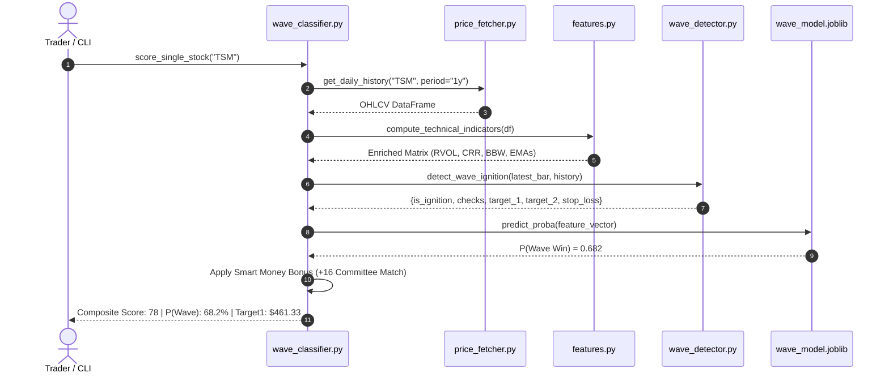
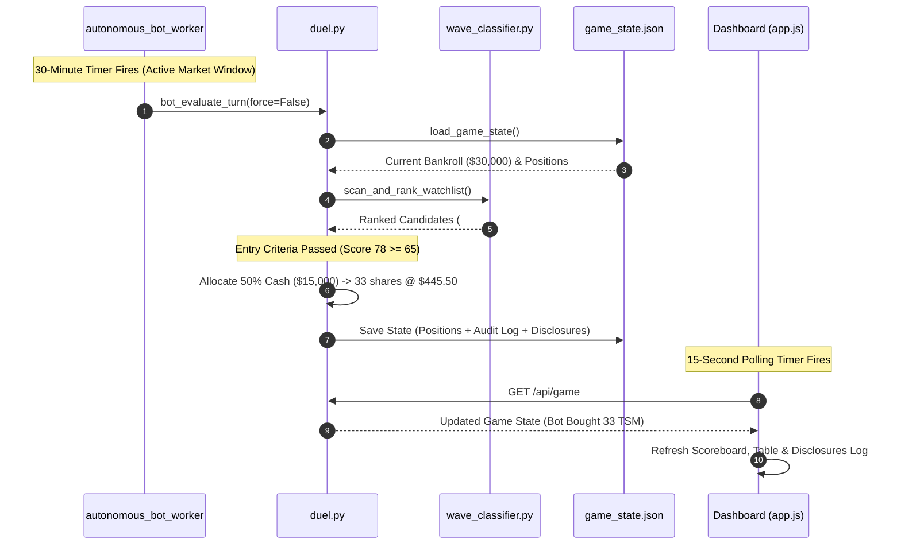

# Wave Rider: Software Design Specification (SDS)
## Detailed Technical Blueprint & Component Architecture

- **Project**: `predict-stock` (Wave Rider Quantitative Momentum & Smart-Money Engine)
- **Standard**: IEEE 1016-2009 Software Design Description (SDD)
- **Status**: Production Reference Design
- **Runtime Environment**: Python 3.12 / Flask / Scikit-Learn / Local Disk Persistence
- **Zero-Cloud / Zero-LLM Mandate**: 100% Local Execution, Zero Ongoing API Costs

---

## 1. System Overview & Architectural Topology

Wave Rider is designed as a **modular, layered quantitative trading and forensic intelligence engine**. It decomposes into five functional layers:

```
┌─────────────────────────────────────────────────────────────────────────────┐
│                           PRESENTATION LAYER                                │
│   • Flask REST API (`app.py`) • Glassmorphism UI (`index.html`, `app.js`)   │
│   • Live Radar Table • Stock Deep-Dive Drawer • 5-Day Duel Trading Desk     │
└──────────────────────────────────────┬──────────────────────────────────────┘
                                       │ HTTP / JSON
                                       ▼
┌─────────────────────────────────────────────────────────────────────────────┐
│                        SIMULATION & EXECUTION LAYER                         │
│   • Live Paper Trading Duel (`duel.py`) • Walkforward Engine (`backtester.py`)│
│   • Background Bot Worker Daemon (30m Market Window / 60m Off-Hours)        │
└──────────────────────────────────────┬──────────────────────────────────────┘
                                       │
                                       ▼
┌─────────────────────────────────────────────────────────────────────────────┐
│                      ANALYTICS & CLASSIFICATION LAYER                       │
│   • Calibrated Gradient Boosting (`wave_classifier.py`)                      │
│   • Day-1 Wave Ignition Rule Engine (`wave_detector.py`)                    │
│   • Point-in-Time Technical Feature Engineering (`features.py`)              │
└──────────────────────────────────────┬──────────────────────────────────────┘
                                       │
                                       ▼
┌─────────────────────────────────────────────────────────────────────────────┐
│                         DATA INGESTION PIPELINE                             │
│   • Price Fetcher (`yfinance`) • STOCK Act Scraper (`politician_data.py`)   │
│   • SEC Form 4 Parser (`insider_data.py`) • Contracts (`contracts_data.py`)  │
│   • StockTwits Stream & Pelosi Effect Analyzer (`social_sentiment.py`)      │
└──────────────────────────────────────┬──────────────────────────────────────┘
                                       │
                                       ▼
┌─────────────────────────────────────────────────────────────────────────────┐
│                          LOCAL STORAGE LAYER                                │
│   • `data/watchlist.json` • `data/game_state.json` • `data/cache/*.json`   │
│   • `models/wave_model.joblib` (Calibrated Classifier Artifact)             │
└─────────────────────────────────────────────────────────────────────────────┘
```

---

## 2. Directory Structure & File Responsibilities

```
predict-stock/
├── data/
│   ├── watchlist.json           # 50 curated US equities with roles & sectors
│   ├── game_state.json          # Duel state (bankrolls, positions, audit log)
│   └── cache/                   # Disk cache for prices, SEC filings, contracts
├── models/
│   └── wave_model.joblib        # Persisted calibrated ML model artifact
├── src/
│   ├── fetchers/
│   │   ├── price_fetcher.py     # OHLCV bars & pre-market quote streams
│   │   ├── politician_data.py   # Congressional STOCK Act & Committee matching
│   │   ├── insider_data.py      # SEC Form 4 C-Suite & cluster accumulation
│   │   ├── contracts_data.py    # USASpending.gov federal contracts engine
│   │   └── social_sentiment.py  # StockTwits streams & Pelosi Effect diagnostics
│   ├── analysis/
│   │   ├── features.py          # Point-in-time quantitative feature engineering
│   │   ├── wave_detector.py     # 4 Core Day-1 Wave Ignition rules
│   │   └── wave_classifier.py   # ML classifier & 0-100 composite scoring
│   ├── backtest/
│   │   └── backtester.py        # Walkforward trade simulator (+3.5% / +6.0% / -2.5%)
│   ├── game/
│   │   └── duel.py              # 5-Day Duel engine & autonomous bot worker
│   ├── dashboard/
│   │   ├── app.py               # Flask web server & background daemon
│   │   ├── templates/index.html # Interactive single-page dashboard
│   │   └── static/
│   │       ├── app.js           # Client interaction, charting, auto-poll loop
│   │       └── style.css        # Responsive dark glassmorphism design system
│   └── main.py                  # Multi-cadence CLI entry point
├── tests/                       # 34 automated unit, integration & API tests
├── ARCHITECTURE.md              # High-Level Architecture & Concept of Operations
├── FUNCTIONAL_REQUIREMENTS.md   # Functional Requirements Specification (FRS) & RTM
├── DESIGN_SPECIFICATION.md      # Software Design Specification (This Document)
└── BACKLOG.md                   # Product Backlog & Engineering Roadmap
```

---

## 3. Data Models & Physical Schemas

### 3.1 Watchlist Schema (`data/watchlist.json`)
```json
{
  "updated_at": "2026-09-28",
  "universe_size": 50,
  "stocks": [
    {
      "ticker": "TSM",
      "name": "Taiwan Semiconductor Manufacturing Co. (ADR)",
      "category": "AI Compute & Systems",
      "exchange": "NYSE",
      "role": "Exclusive Advanced Foundry (N3/N2) for NVDA, AAPL, AMD"
    }
  ]
}
```

### 3.2 Duel Game State Schema (`data/game_state.json`)
```json
{
  "game_id": "duel_2026_10_02",
  "title": "5-Day Live Wave Rider Duel: Player vs. Bot",
  "created_at": "2026-09-28T13:40:27.866832+00:00",
  "end_time": "2026-10-02T21:00:00Z",
  "initial_capital": 30000.0,
  "rules": {
    "starting_cash": 30000.0,
    "allowed_universe_count": 50,
    "shorting_allowed": false,
    "allocation_limits": "None (Total Freedom)",
    "end_time_cet": "Friday Oct 2, 2026 at 23:00 CET"
  },
  "player": {
    "cash": 30000.0,
    "positions": [
      {
        "ticker": "NVDA",
        "shares": 50,
        "avg_price": 120.50,
        "cost_basis": 6025.00,
        "opened_at": "2026-09-28 14:00 UTC"
      }
    ],
    "history": []
  },
  "bot": {
    "cash": 30000.0,
    "positions": [],
    "history": [],
    "decision_logs": [
      {
        "time": "2026-09-28 14:10 UTC",
        "action": "BUY",
        "ticker": "TSM",
        "shares": 33,
        "price": 445.50,
        "total_usd": 14701.50,
        "rationale": "Day-1 Wave Ignition: RANGE_BREAKOUT with RVOL 1.85x and P(Wave) of 68.2%...",
        "composite_score": 78,
        "wave_probability": 68.2
      }
    ],
    "last_evaluated_at": "2026-09-28 14:10 UTC"
  }
}
```

---

## 4. Module & Component Design

### 4.1 Ingestion Layer (`src/fetchers/`)

#### 1. `price_fetcher.py`
* **`get_daily_history(ticker: str, period: str = "1y") -> pd.DataFrame`**: Fetches historical daily OHLCV bars. Checks `data/cache/{ticker}_daily.parquet`. If cache age $< 12\text{ hours}$, returns cached DataFrame; otherwise fetches from Yahoo Finance, writes to cache, and returns.
* **`get_premarket_quote(ticker: str) -> Dict[str, Any]`**: Ingests overnight quote, extracts `current_price` and `previous_close`, computes `gap_pct`.

#### 2. `politician_data.py`
* **`fetch_congress_trades(force_refresh: bool = False) -> List[Dict[str, Any]]`**: Scrapes CapitolTrades public filings. Normalizes names (e.g. `'Rick AllenRepublicanHouseGA'` $\rightarrow$ `'Rick Allen'`).
* **`get_politician_committee_info(politician_raw: str) -> Dict[str, Any]`**: Maps normalized names to official committees (118th/119th Congress). Matches against `HIGH_ALPHA_TECH_COMMITTEES` (Energy & Commerce, Armed Services, Science & Tech, Foreign Affairs) to assign $2.5\times$ conviction multiplier.
* **`get_ticker_congress_signals(ticker: str, days: int = 90) -> Dict[str, Any]`**: Computes Congressional Score ($-20$ to $+100$), tracks buy/sell count, and returns enriched list of all trades.

#### 3. `insider_data.py`
* **`get_insider_signals(ticker: str, days: int = 90) -> Dict[str, Any]`**: Parses open-market Form 4 purchases. Identifies C-Suite buyers (`chief`, `ceo`, `cfo`, `director`) and flags cluster buys ($\ge 2$ distinct insiders in 30 days).

#### 4. `contracts_data.py`
* **`fetch_federal_contracts(ticker: str) -> List[Dict[str, Any]]`**: Queries `api.usaspending.gov/api/v2/search/spending_by_award/` prime contract awards. Caches response in `data/cache/{ticker}_contracts.json` (TTL: 24 hours).
* **`get_ticker_contract_signals(ticker: str) -> Dict[str, Any]`**: Calculates contract score (0–100), total value USD, top award amount, defense presence flag (`is_defense_contract`), and agency list.

#### 5. `social_sentiment.py`
* **`get_ticker_social_sentiment(ticker: str) -> Dict[str, Any]`**: Ingests live StockTwits symbol streams (`/api/2/streams/symbol/{ticker}.json`) and financial headlines. Evaluates copy-trading velocity, generates the Pelosi Effect diagnostic dictionary (`intensity`, `primary_catalyst`, `prominent_figures`, `lifecycle_stage`, `narrative_summary`, `verbatim_quotes`).

---

### 4.2 Analytics & Wave Detection (`src/analysis/`)

#### 1. `features.py`
* **`compute_technical_indicators(df: pd.DataFrame) -> pd.DataFrame`**: Computes point-in-time indicators without forward lookahead:
  * $\text{SMA}_{20}(\text{Close})$, $\text{EMA}_5(\text{Close})$, $\text{EMA}_{20}(\text{Close})$
  * $\text{RVOL}_{20} = \text{Volume} / \text{SMA}_{20}(\text{Volume})$
  * $\text{CRR} = (\text{Close} - \text{Low}) / (\text{High} - \text{Low})$
  * $\text{Upper BB} = \text{SMA}_{20} + 2\sigma, \quad \text{Lower BB} = \text{SMA}_{20} - 2\sigma$
  * $\text{BBW} = (\text{Upper BB} - \text{Lower BB}) / \text{SMA}_{20}$
* **`create_wave_target(df: pd.DataFrame, forward_bars: int = 5, gain_threshold: float = 0.035, stop_loss: float = -0.025) -> pd.Series`**: Generates binary target labels for machine learning training.

#### 2. `wave_detector.py`
* **`detect_wave_ignition(latest_bar: pd.Series, historical_slice: pd.DataFrame) -> Dict[str, Any]`**:
  Evaluates the 4 Core Wave Ignition Rules:
  1. `RVOL >= 1.50`
  2. `CRR >= 0.68`
  3. `Close >= 20D High` OR `Close >= Upper BB`
  4. `Close <= Upper BB * 1.015` (Anti-Exhaustion Guard)
  Returns boolean `is_ignition`, `ignition_type`, `checks`, and bracket levels (`target_1`, `target_2`, `stop_loss`).

#### 3. `wave_classifier.py`
* **`train_wave_model() -> Dict[str, Any]`**: Fits `HistGradientBoostingClassifier` with `TimeSeriesSplit(n_splits=3)` and `CalibratedClassifierCV(cv=3)`. Saves model to `models/wave_model.joblib`.
* **`score_single_stock(ticker: str) -> Dict[str, Any]`**: Scores stock today, predicts $P(\text{Wave Win})$, applies Smart Money bonus schedule, and outputs unified Composite Score (0–100).
* **`scan_and_rank_watchlist() -> List[Dict[str, Any]]`**: Evaluates all 50 stocks, sorts descending by composite score, and powers the live radar table.

---

### 4.3 Simulation & Duel Execution (`src/game/` & `src/backtest/`)

#### 1. `duel.py`
* **`get_live_duel_status() -> Dict[str, Any]`**: Computes mark-to-market valuations for player and bot portfolios using live prices. Determines current match leader and formatted countdown.
* **`execute_player_order(action: str, ticker: str, shares: int) -> Dict[str, Any]`**: Validates bankroll, universe inclusion, and long-only constraints. Atomically updates `game_state.json`.
* **`bot_evaluate_turn(force: bool = False) -> Dict[str, Any]`**: Evaluates bot turn. If candidates meet entry thresholds ($\text{is\_ignition} \lor \text{score} \ge 65 \lor P(\text{Wave}) \ge 65\%$), executes conviction-sized position and logs transparent rationale citing all technical and fundamental catalysts.

---

### 4.4 Web Front-End Presentation Architecture (`src/dashboard/static/` & `templates/`)

#### 1. UI Technology Stack & Design System
* **HTML5 Single-Page Application (`templates/index.html`)**: Semantic single-page application hosting 4 dynamic view panels (`tab-radar`, `tab-deepdive`, `tab-backtest`, `tab-duel`), persistent top header, and universe overview KPI strip.
* **CSS3 Glassmorphic Styling (`static/style.css`)**: Glassmorphism design system using semi-transparent frosted cards (`background: rgba(15, 23, 42, 0.75)`, `backdrop-filter: blur(12px)`), dark slate palette (`#090d16`, `#0f172a`), neon accent borders (`#00f2fe`, `#4facfe`, `#10b981`), and responsive CSS flexbox/grid layouts.
* **Hardware-Accelerated Canvas Charting**: Chart.js 4.x integration for 60-day multi-overlay price charts (EMAs, Target 1, Target 2, Stop loss) and backtest equity growth curves.

#### 2. Client-Side State Model (`static/app.js`)
* **State Variables**:
  * `currentMode`: Active operational scanning mode (`eod` vs `premarket`).
  * `radarData`: Cached array of ranked 50-stock payload objects enabling instant client-side category filtering.
  * `deepDiveChart`: Active Chart.js instance for the 60-day technical canvas.
  * `equityChart`: Active Chart.js instance for the backtest equity curve canvas.
  * `duelPollingInterval`: 15-second background polling timer (`setInterval(loadDuelState, 15000)`).

#### 3. Front-End Controller Modules
* **Navigation Router (`showTab(tabName)`)**: Swaps visible tab panels without page reloads, cleanly initializes canvas contexts, and triggers tab-specific data fetches.
* **Wave Radar Controller (`loadRadar()`, `filterCategory(cat)`)**: Ingests `/api/radar`, executes instant DOM filtering across 5 industry sectors, and populates the 13-column quantitative screening table.
* **Stock Deep-Dive Controller (`loadDeepDive(ticker)`, `renderDeepDiveChart()`)**: Consumes `/api/stock/<ticker>`, renders 4-pillar forensic scorecards, plots multi-overlay price history, and builds tabular audit grids for Congressional trades, Form 4 insider buys, and USASpending federal contracts.
* **Backtest Laboratory Controller (`executeBacktest()`)**: Ingests `/api/backtest`, binds 6 KPI summary cards, renders the portfolio equity curve, and renders the chronological trade execution ledger.
* **Duel Desk Controller (`loadDuelState()`, `submitOrder()`, `triggerBotTurn()`, `resetDuel()`)**: Manages the live paper trading terminal, computes dynamic countdowns to Oct 2 23:00 CET, calculates order totals on keystroke, renders mark-to-market open positions, logs transparent bot disclosures, and runs the 15-second background polling cycle.

---

## 5. REST API Interface Specification

### `GET /api/radar`
* **Parameters**: `mode` (`eod` | `premarket`), `refresh` (`true` | `false`)
* **Response `200 OK`**:
```json
[
  {
    "ticker": "TSM",
    "name": "Taiwan Semiconductor Manufacturing Co. (ADR)",
    "category": "AI Compute & Systems",
    "current_price": 445.73,
    "change_pct": 1.45,
    "is_ignition": false,
    "ignition_type": "FLAT",
    "wave_probability": 39.2,
    "composite_score": 63,
    "target_1": 461.33,
    "target_2": 472.47,
    "stop_loss": 434.59,
    "smart_money": {
      "jurisdiction_match": true,
      "politician_buy": true,
      "insider_cluster": false,
      "insider_buy": true,
      "is_pelosi_effect": true,
      "contracts": { "has_major_contract": false }
    }
  }
]
```

### `GET /api/stock/<ticker>`
* **Response `200 OK`**:
```json
{
  "ticker": "DELL",
  "name": "Dell Technologies Inc.",
  "category": "AI Compute & Systems",
  "role": "Tier-1 Enterprise AI Server & Storage Architecture",
  "current_price": 544.24,
  "change_pct": 2.10,
  "date": "2026-09-28",
  "wave_probability": 41.7,
  "composite_score": 53,
  "technicals": {
    "rvol_20d": 0.08,
    "crr": 0.03,
    "bb_width": 0.115,
    "ema5": 541.20,
    "ema20": 532.40,
    "volume": 240100,
    "vol_sma20": 3050000
  },
  "smart_money": {
    "congress_trades": [],
    "total_buy_value_usd": 0.0,
    "c_suite_buyers": [],
    "recent_transactions": [],
    "contracts": {
      "contract_score": 100,
      "total_value_usd": 8883005113.85,
      "top_award_amount_usd": 1730532626.58,
      "is_defense_contract": true,
      "top_agencies": ["Department of Defense", "Department of Veterans Affairs"],
      "recent_contracts": []
    },
    "pelosi_effect": {
      "is_active": true,
      "intensity": "HIGH_VELOCITY",
      "hype_score": 70,
      "primary_catalyst": "C_SUITE_INSIDER_WHALE_ACCUMULATION",
      "prominent_figures": ["Corporate CEO"],
      "narrative_summary": "Retail social streams actively circulating whale accumulation chatter...",
      "verbatim_quotes": ["Whales stepping into enterprise AI infrastructure..."]
    }
  },
  "checks": [
    { "rule": "Relative Volume Expansion", "passed": false, "detail": "RVOL 0.08x < 1.50x required" }
  ],
  "history": [
    { "date": "2026-09-28", "open": 540.0, "high": 546.0, "low": 538.5, "close": 544.24, "volume": 240100, "ema5": 541.2, "ema20": 532.4 }
  ]
}
```

### `GET /api/game`
* **Response `200 OK`**:
```json
{
  "countdown": "4d 5h 22m remaining",
  "leader": "TIED",
  "lead_label": "⚖️ Tied ($30,000 Starting Line)",
  "next_bot_run": "2026-09-28 16:10 UTC",
  "player": {
    "cash": 30000.0,
    "stock_value": 0.0,
    "net_equity": 30000.0,
    "total_pnl": 0.0,
    "total_pnl_pct": 0.0,
    "positions": []
  },
  "bot": {
    "cash": 30000.0,
    "stock_value": 0.0,
    "net_equity": 30000.0,
    "total_pnl": 0.0,
    "total_pnl_pct": 0.0,
    "positions": [],
    "decision_logs": []
  }
}
```

---

## 6. Concurrency, Threading & Bot Daemon Architecture

The autonomous bot runs as a background thread managed inside `src/dashboard/app.py`:

```
                 [Flask Application Startup]
                             │
                             ▼
                 [start_bot_daemon()]
                             │
                             ▼
               [autonomous_bot_worker() Thread]
                             │
                             ▼
                     Wait 5 seconds
                             │
                             ▼
              [Initial Portfolio Evaluation]
                             │
            ┌────────────────┴────────────────┐
            │                                 │
            ▼                                 ▼
   [is_us_market_window()] == True    [is_us_market_window()] == False
            │                                 │
            ▼                                 ▼
    interval = 1800s (30m)             interval = 3600s (60m)
            │                                 │
            └────────────────┬────────────────┘
                             │
                             ▼
           [BOT_STOP_EVENT.wait(interval)]
                             │
                             ▼
         [bot_evaluate_turn(force=False)]
                             │
                             ▼
             [Evaluate Candidate Setups]
       (is_ignition OR score >= 65 OR P >= 65%)
            ┌────────────────┴────────────────┐
            │ Yes                             │ No
            ▼                                 ▼
   [Execute Conviction Buy]             [Log Balanced & Hold]
   [Append Transparent Disclosure]                    │
            │                                         │
            └────────────────┬────────────────────────┘
                             │
                             ▼
                       Repeat Loop
```

### Threading Safeguards
* **`BOT_STOP_EVENT = threading.Event()`**: Enables graceful shutdown when Flask terminates without leaving orphan processes.
* **Atomic State Persistence**: `save_game_state(state)` writes state atomically to `data/game_state.json` via file replacement to prevent corrupt JSON reads from concurrent threads.
* **Client-Side Non-Blocking Polling**: The frontend initiates `setInterval(loadDuelState, 15000)` only when the Duel tab is active, clearing the interval when switching away.

---

## 7. Sequence Diagrams

### 7.1 Day-1 Wave Ignition Detection Sequence


### 7.2 Autonomous Bot Execution Sequence


---

## 8. Requirements Traceability Cross-Reference

Every component in this design specification maps directly to the corresponding requirement in [`FUNCTIONAL_REQUIREMENTS.md`](file:///c:/Users/jonsa/LLM/predict-stock/FUNCTIONAL_REQUIREMENTS.md):

* **Asset Ingestion & Cache (`price_fetcher.py`)** $\rightarrow$ `FR-01-01`, `FR-01-02`, `FR-01-03`
* **Congressional Tracker (`politician_data.py`)** $\rightarrow$ `FR-02-01`, `FR-02-02`, `FR-02-03`
* **Corporate Insiders (`insider_data.py`)** $\rightarrow$ `FR-02-04`
* **Federal Contracts (`contracts_data.py`)** $\rightarrow$ `FR-02-05`, `FR-02-06`
* **Social & Pelosi Effect (`social_sentiment.py`)** $\rightarrow$ `FR-03-01`, `FR-03-02`, `FR-03-03`
* **Feature Matrix (`features.py`)** $\rightarrow$ `FR-03-04`, `FR-03-05`, `FR-03-06`
* **Ignition Rules (`wave_detector.py`)** $\rightarrow$ `FR-04-01`, `FR-04-02`, `FR-04-03`
* **Walkforward Simulator (`backtester.py`)** $\rightarrow$ `FR-04-04`
* **ML Model & Scoring (`wave_classifier.py`)** $\rightarrow$ `FR-05-01`, `FR-05-02`
* **Duel Game Engine (`duel.py`)** $\rightarrow$ `FR-06-01`, `FR-06-02`, `FR-06-03`, `FR-06-04`, `FR-06-05`, `FR-06-06`
* **REST Dashboard API (`app.py`, `app.js`)** $\rightarrow$ `FR-06-07` through `FR-06-13`
* **Cloud Architecture Blueprint** $\rightarrow$ `FR-07-01`, `FR-07-02`

---

## 9. Future Cloud Architecture Blueprint (`DEP-01` / `DEP-02`)

When transitioning from local execution to 24/7 cloud hosting:

```
┌─────────────────────────────────────────────────────────────────────────────┐
│                 FREE-TIER CLOUD RUNTIME (Render / HF Spaces)                │
│                                                                             │
│   ┌───────────────────────────┐         ┌───────────────────────────────┐   │
│   │   Flask Web App (Gunicorn)│         │ Autonomous Bot Daemon Worker  │   │
│   │   Port: 7860 or 10000     │         │ Thread: 30m / 60m loop        │   │
│   └─────────────┬─────────────┘         └──────────────┬────────────────┘   │
│                 │                                      │                    │
│                 ▼                                      ▼                    │
│        [REST API Endpoints]                   [Market Evaluator]            │
│                 │                                      │                    │
│                 └──────────────────┬───────────────────┘                    │
│                                    │                                        │
│                                    ▼                                        │
│                   [Supabase PostgreSQL Client Engine]                       │
└────────────────────────────────────┬────────────────────────────────────────┘
                                     │ SSL / HTTPS Connection
                                     ▼
┌─────────────────────────────────────────────────────────────────────────────┐
│                 EXTERNAL DATABASE PERSISTENCE (Supabase Free Tier)          │
│   • Table `game_sessions`: `game_id`, `created_at`, `rules`                 │
│   • Table `duel_portfolios`: `participant`, `cash`, `equity`, `updated_at`  │
│   • Table `duel_positions`: `ticker`, `shares`, `avg_price`, `cost_basis`   │
│   • Table `duel_audit_log`: `tx_id`, `action`, `price`, `rationale`         │
└─────────────────────────────────────────────────────────────────────────────┘
```

1. **State Persistence**: The local file I/O operations (`load_game_state`, `save_game_state`) will be augmented with a database driver fallback that synchronizes to Supabase PostgreSQL whenever database environment variables are set.
2. **Preventing Spin-Down**: A free external uptime pinger (e.g. Cron-Job.org or UptimeRobot) pings `GET /api/health` every 14 minutes, keeping the free-tier container active throughout the 5-day duel.
