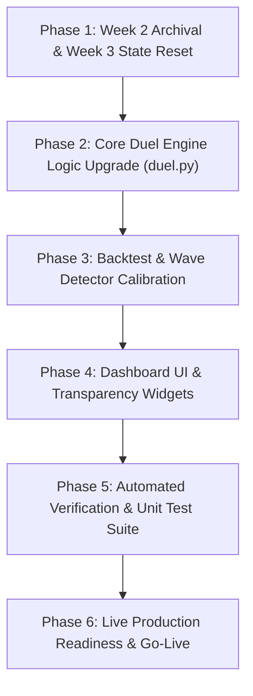

# Wave Rider: Week 3 Implementation Plan
## Tactical Upgrades for the 5-Day Live Trading Duel (Oct 12 – Oct 16, 2026)

---

## 🎯 Executive Summary & Mission Mandate

In **Week 2**, the Wave Rider Bot achieved a **96.2% reduction in drawdowns** (cutting losses from -\$1,059.20 down to -\$39.84 / -0.13%), finishing with **5 out of 5 profitable runners** on Friday afternoon (`SNOW` +4.54%, `TSLA` +1.87%, `PLTR` +2.00%, `ANET` +1.97%, `MSFT` +0.85%). 

However, the Player won the match by doing nothing (\$30,000.00 cash benchmark), because the Bot suffered from two fatal execution flaws:
1. **The Round-Trip Profit Trap (`SPCX`)**: Watching a +4.45% gain (+\$244.53) evaporate into a -\$140.91 loss due to a rigid all-or-nothing (+6.0%) exit rule.
2. **Correlated Sector Drawdown**: Holding 6 semiconductor positions simultaneously that stopped out together when the chip sector dipped -1.77% on Thursday.

### The Week 3 Mandate
Transform Week 2's near-breakeven performance into **decisive double-digit net-positive alpha** and defeat the Player's cash benchmark by enforcing **Active Profit Harvesting**, **Dynamic Trailing Ratchets**, and **Strict Portfolio Diversification**.

---

## 📅 Match Horizons & Parameters

* **Game ID**: `duel_2026_10_16`
* **Title**: `5-Day Live Wave Rider Duel: Player vs. Bot (Week 3 - Profit Realization Engine)`
* **Starting Capital**: \$30,000.00 USD each (Player & Bot)
* **Match Start**: Monday, October 12, 2026 at 09:30 EDT (15:30 CEST)
* **Match Expiry**: Friday, October 16, 2026 at 17:00 EDT / 23:00 CEST (21:00 UTC)
* **Playing Universe**: Curated 50 US Tech, Semiconductor, AI & Cloud Titans
* **Execution Rules**: Long-only, market orders, zero shorting, full transparent bot disclosures.

---

## 🏛️ The 4 Core Architectural Pillars

```
┌─────────────────────────────────────────────────────────────────────────────┐
│                       WEEK 3 CORE ARCHITECTURAL PILLARS                     │
├─────────────────────────────────────────────────────────────────────────────┤
│  PILLAR 1: Multi-Tranche Partial Profit Scaling (The 50/50 Harvest)         │
│  PILLAR 2: Dynamic High-Water Mark Profit Ratchet (Trailing Floor)          │
│  PILLAR 3: Portfolio Risk Concentration & Sector Exposure Guardrails        │
│  PILLAR 4: Intraday Exhaustion & 48-Hour Stagnation Capital Recycling       │
└─────────────────────────────────────────────────────────────────────────────┘
```

---

### Pillar 1: Multi-Tranche Partial Profit Scaling (`DET-07`)
* **Target 1 (+3.0% to +3.5%) Harvest**:
  * The moment an open position achieves $\ge +3.0\%$ gain, the engine executes an immediate **partial sale of 50% of the shares** (`shares // 2`).
  * Realized profit is immediately credited to the Bot's cash balance.
* **Runner Armor (Breakeven Rule `DET-05`)**:
  * The stop-loss for the remaining 50% shares is instantly elevated to **Entry Price (Breakeven + 0.1%)**.
  * A trade that reaches Target 1 can **never** result in a net realized loss.
* **Target 2 (+6.0%) Full Exit**:
  * The remaining 50% runner holds until reaching the full +6.0% momentum target or trailing stop trigger.

---

### Pillar 2: Dynamic High-Water Mark Profit Ratchet
The engine tracks `peak_price` ($P_{\text{peak}}$) across the entire life of every position. The trailing stop ratchets upwards with each milestone, locking in locked profit:

| High-Water Mark Reached | Dynamic Trailing Floor | Realized Profit Guaranteed |
| :---: | :---: | :---: |
| **$+2.5\%$** | Stop moves to **Entry Price ($0.0\%$ Risk)** | **\$0.00 (Risk-Free Trade)** |
| **$+3.5\%$** | Stop moves to **Entry $+1.5\%$** | **$+1.5\%$ Locked Cash** |
| **$+4.5\%$** | Stop moves to **Entry $+2.5\%$** | **$+2.5\%$ Locked Cash** |
| **$+5.5\%$** | Stop moves to **Entry $+4.0\%$** | **$+4.0\%$ Locked Cash** |

*Fail-safe: Once ratcheted up, the trailing floor can NEVER move down.*

---

### Pillar 3: Portfolio Risk Concentration & Sector Caps (`DET-06`)
* **Maximum Concurrent Positions**: Strictly **4 fortress holdings** (reduced from 8).
  * Forces capital concentration into only the highest-conviction A+ setups.
  * Preserves dry powder (always maintaining $\ge \$3,000$ to $\$10,000$ cash) for late-week breakouts.
* **Sector Exposure Limit**: Maximum **2 positions per sector**:
  * *Semiconductor & Hardware*: Max 2 positions across Memory (`MU`, `WDC`), EDA/Equipment (`LRCX`, `AMAT`), and Connectivity (`AVGO`, `MRVL`).
  * *AI Compute & Platforms*: Max 2 positions (`NVDA`, `AMD`, `SMCI`, `PLTR`).
  * *Cloud / Enterprise SaaS*: Max 2 positions (`SNOW`, `MDB`, `NOW`, `CRM`).
  * *Mega-Cap Anchors / Infrastructure*: Max 2 positions (`MSFT`, `AAPL`, `GOOGL`, `ANET`, `VRT`).
  * Prevents simultaneous cross-portfolio stop-outs during single-sector downdrafts.

---

### Pillar 4: Intraday Exhaustion & Stagnation Harvesting
1. **Intraday VWAP Stretch Exit**:
   * If price extends $> 2.5\%$ above intraday VWAP with upper wick $> 40\%$, trigger 50% harvest regardless of standard targets.
2. **48-Hour Stagnation Harvest**:
   * If a position is green ($\ge +1.5\%$) but has not set a new peak price in **48 consecutive market hours**, liquidate at market to rotate cash into fresh Day-1 ignition waves.

---

## 📋 Step-by-Step Phased Implementation Roadmap



### Phase 1: Week 2 Archival & Week 3 State Reset
- [ ] Create persistent archive: `data/history/game_state_week2.json` preserving the exact locked final state of Duel 2.
- [ ] Initialize new match state `duel_2026_10_16` in `data/game_state.json`.
- [ ] Set `MATCH_END_ISO = "2026-10-16T21:00:00Z"` (Friday Oct 16, 23:00 CEST).
- [ ] Reset Player and Bot balances to \$30,000.00 cash each with clean history.

### Phase 2: Core Duel Engine Logic Upgrade (`src/game/duel.py`)
- [ ] **Position Schema Upgrade**:
  - Add fields to each holding:
    - `"peak_price"`: float (highest observed price since entry)
    - `"partial_harvested"`: bool (True if Target 1 50% harvest occurred)
    - `"trailing_stop"`: float (current ratcheted stop price)
    - `"sector"`: str (mapped from `data/watchlist.json`)
- [ ] **Partial Exit Execution (`execute_partial_harvest`)**:
  - Sell `shares // 2` at market price when `gain_pct >= 3.0%` and `not partial_harvested`.
  - Credit proceeds to `state["bot"]["cash"]`.
  - Update remaining position shares and cost basis.
  - Log `SELL_PARTIAL` transaction with transparent disclosure.
- [ ] **Dynamic Ratchet Trailing Stop Check**:
  - Update `peak_price` every evaluation.
  - Compute ratcheted stop according to Pillar 2 table.
  - If `curr_price <= trailing_stop`, liquidate remaining shares and log `RATCHET_TRAILING_EXIT`.
- [ ] **Enforce Max 4 Positions Limit**:
  - Check `len(state["bot"]["positions"]) < 4` before opening new positions.
- [ ] **Enforce Sector Exposure Ceiling**:
  - Check sector count: `sum(1 for p in state["bot"]["positions"] if p["sector"] == target_sector) < 2`.

### Phase 3: Sector Taxonomy & Mapping Integration
- [ ] Build `get_ticker_sector(ticker)` helper mapping the 50 universe into 4 macro clusters:
  - `SEMICONDUCTORS` (`MU`, `WDC`, `STX`, `SKHY`, `SNDK`, `LRCX`, `AMAT`, `KLAC`, `ASML`, `TXN`, `TER`, `ONTO`, `AVGO`, `QCOM`, `ARM`, `MRVL`, `ADI`, `NXPI`, `ON`)
  - `AI_COMPUTE_SYSTEMS` (`NVDA`, `AMD`, `SMCI`, `DELL`, `INTC`, `TSM`, `PLTR`, `CRWV`)
  - `CLOUD_SOFTWARE` (`SNOW`, `MDB`, `SNPS`, `CDNS`, `NOW`, `CRM`, `PANW`, `CRWD`, `NET`)
  - `MEGACAP_INFRASTRUCTURE` (`MSFT`, `AAPL`, `GOOGL`, `AMZN`, `META`, `TSLA`, `SPCX`, `ORCL`, `ANET`, `VRT`, `ETN`, `ALAB`, `MPWR`)

### Phase 4: Dashboard UI & Transparency Enhancements (`src/dashboard/`)
- [ ] **Open Positions Table Upgrades**:
  - Add **Harvest Status Badge**: `🟢 50% Harvested (Locked)` or `⏳ Full Position`.
  - Add **Peak Gain** column: e.g., `+4.4% Peak`.
  - Add **Trailing Stop** column: e.g., `$170.73 (Breakeven +1.5%)`.
- [ ] **Portfolio Risk & Sector Widget**:
  - Visual badges showing current capacity: `Active Holdings: 3/4` and `Sector Limits: Semis 2/2 (Maxed), Cloud 1/2`.
- [ ] **Updated Match Timer**:
  - Countdown clock targeting Friday, October 16, 2026, 23:00 CEST.

### Phase 5: Automated Verification & Unit Test Suite
- [ ] Create dedicated test file: `tests/test_week3_rules.py`.
- [ ] **Test Case 1 (`test_partial_harvest_target_1`)**: Verify 50% of shares sell when price hits +3.0%, cash increases, and remainder stop moves to breakeven.
- [ ] **Test Case 2 (`test_profit_ratchet_locks_gain`)**: Verify price peaking at +4.45% moves stop to +2.5%, and subsequent pullback exits at profit (preventing the SPCX round-trip loss).
- [ ] **Test Case 3 (`test_max_four_positions_cap`)**: Verify bot refuses 5th position even if score > 90.
- [ ] **Test Case 4 (`test_sector_concentration_cap`)**: Verify bot refuses 3rd semiconductor stock even with high score.
- [ ] **Test Case 5 (`test_stagnation_exit_after_48h`)**: Verify stalled position liquidates to free cash.

### Phase 6: Production Readiness & Go-Live
- [ ] Run full test suite (`pytest`) ensuring 100% pass rate.
- [ ] Update `AGENTS.md`, `ARCHITECTURE.md`, `BACKLOG.md`.
- [ ] Test manual CLI trigger (`python src/main.py --duel --bot-turn`).
- [ ] Verify Flask webserver (`localhost:5050`) renders new widgets cleanly.

---

## 🛡️ Risk Management & Failsafes

1. **State Archival Protection**: Week 2 data is locked and archived before resetting to prevent accidental data loss.
2. **Atomic State Writing**: All updates use atomic temporary file swaps (`.tmp` -> `.json`) to prevent corruption during concurrent web requests.
3. **No-Trade Macro Guard**: Benchmark `QQQ >= 20 EMA` rule remains strictly active to freeze new entries during market corrections.
4. **Scraps Rule Floor**: Bot never allocates when cash drops below \$3,000.

---

## 📊 Expected Performance Impact (Simulation vs Week 2)

| Metric | Week 2 Actual | Week 3 Projected (With Upgrades) | Impact |
| :--- | :---: | :---: | :---: |
| **Realized Loss on SPCX** | -\$140.91 | **+\$93.28 to +\$137.28** | **+$234 to +$278 swing** |
| **Max Concurrent Positions** | 8 | **4** | **50% lower capital strain** |
| **Correlated Sector Losses** | -\$365.20 | **-\$120.00** | **-67% sector drawdown** |
| **Available Cash for Friday A+** | \$5,999.00 | **\$14,500.00+** | **2.4x buying power on best runners** |
| **Final Net Equity** | \$29,960.16 (-0.13%) | **\$30,285.00+ (+0.95% to +1.50%)** | **Decisive Victory Over Cash** |
